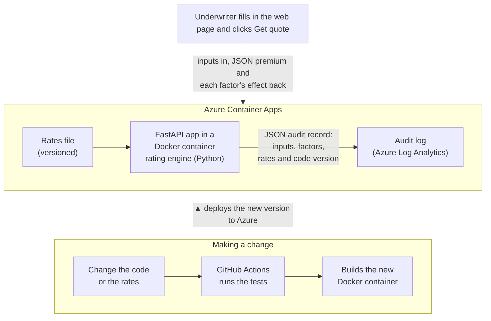

# Marine hull rater

## What this is

This is a working demo of a marine hull rater. It's written in Python and runs on Azure. It isn't tied to any pricing platform: the rating is plain Python code reading a rates file. Whenever anything changes, GitHub Actions tests it and deploys it automatically.

**All rates in this project are made up. They are illustrative, are not based on any real pricing, and must not be used to price real risks.**



## How it works

An underwriter fills in the web page and clicks Get quote. The FastAPI app reads the rates file, works out the premium, and sends it back as JSON, showing how each factor moved the price. Every quote also writes an audit record: what went in, what came out, and which version of the rates and code produced it.

The app runs in a Docker container on Azure Container Apps. Change the code or the rates, and GitHub Actions runs the tests, builds a new container and puts it live.

## In more detail

- [How a quote is worked out](docs/plain-english/how-a-quote-works.md)
- [Where it runs](docs/plain-english/where-it-runs.md)
- [How a change goes live](docs/plain-english/how-a-change-goes-live.md)
- [Reusing it for other classes](docs/plain-english/reusing-it.md)
- For engineers: [architecture](docs/architecture.md) and the [from-scratch guide](docs/from-scratch.md)

## Run it locally

Needs [uv](https://docs.astral.sh/uv/) and Python 3.14.

```sh
uv run pytest
uv run uvicorn app.main:app --reload --port 8000
```

Then open <http://localhost:8000>. Or use Docker:

```sh
docker build --build-arg GIT_COMMIT="$(git rev-parse HEAD)" -t marine-hull-rater .
docker run --rm -p 8000:8000 marine-hull-rater
```

## Notes

- The rating logic could also run on Azure Functions.
- Marine hull is the worked example; the structure can be reused for other classes of business.

## Next steps

- Draft and approval workflows
- Logins
- Version comparison
- A database

## Teardown

Deleting the resource group removes the app, environment, registry, identity and logs. The budget and app registration sit outside it. Find the app ID with `az ad app list --display-name github-marine-hull-rater --query "[].appId" -o tsv`.

```sh
az group delete --name rg-marine-hull-rater
az rest --method delete --url "https://management.azure.com/subscriptions/<subscription-id>/providers/Microsoft.Consumption/budgets/budget-monthly-20?api-version=2023-11-01"
az ad app delete --id <app-id>
gh repo delete mmadahar/marine-hull-rater
```
