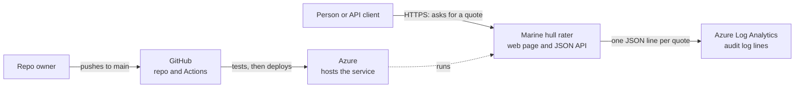
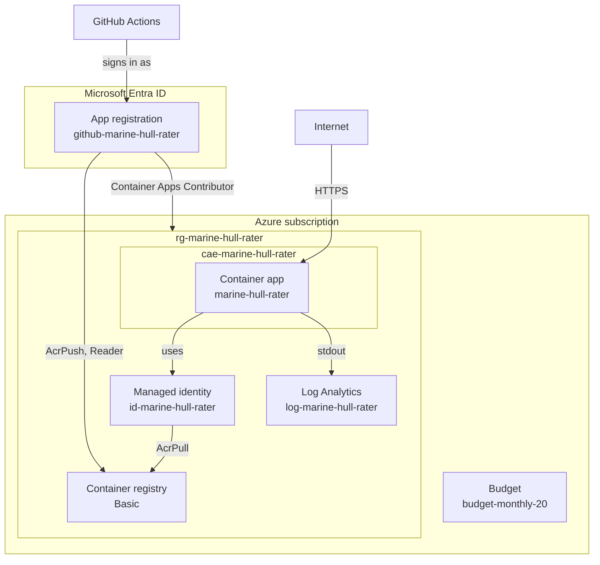
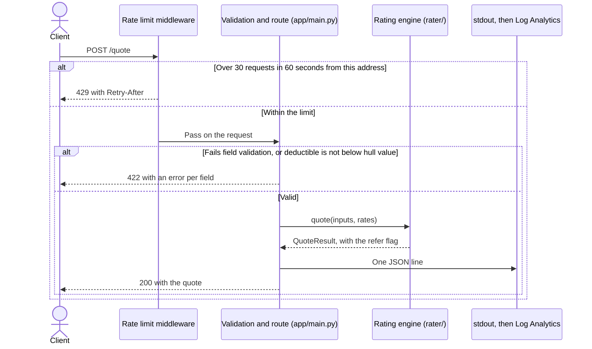
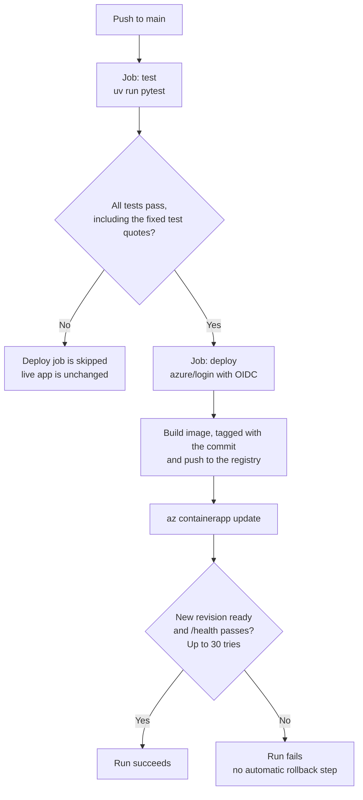
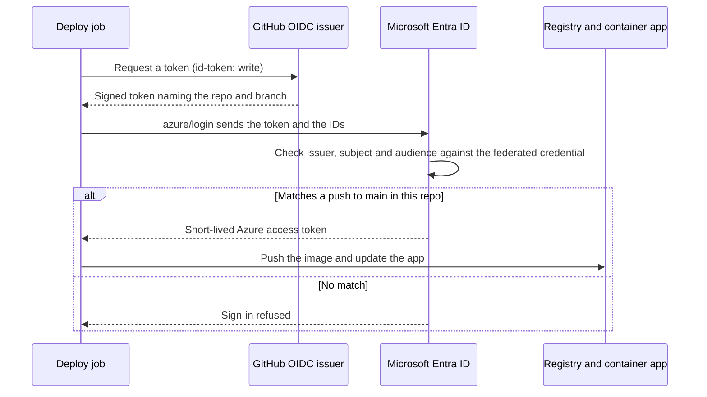
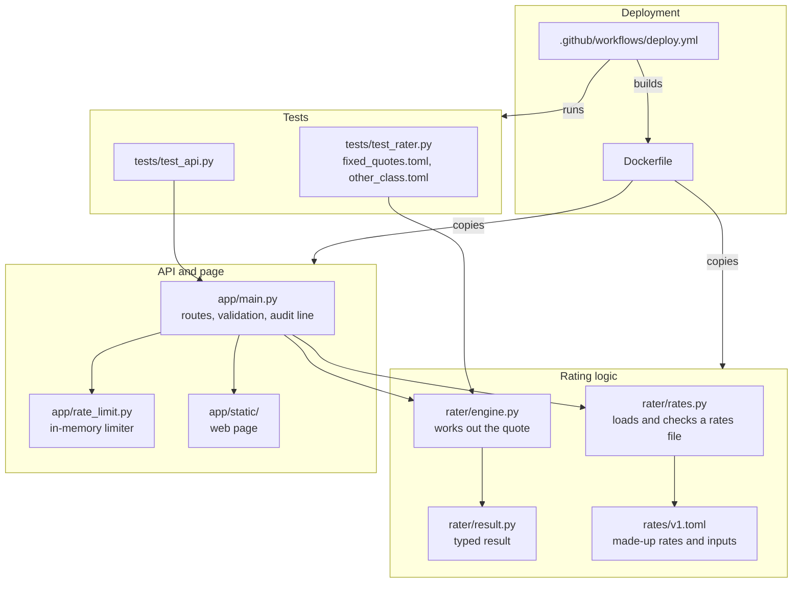

# Architecture

This is a small web service that prices a marine hull risk from a rates file. It runs on Azure Container Apps and deploys from GitHub Actions.

**All rates are made up.** They are illustrative, are not based on any real pricing, and must not be used to price real risks.

Names in angle brackets, such as `<registry>`, stand in for values left out of this document.

## System context

A person uses the web page, or a client calls the API directly. There are no logins and no database. Nothing calls out to another system to work out a quote.

## Azure components

Everything runs in UK South. The resource group is `rg-marine-hull-rater`. The app registration and the budget sit outside it.

| Component | Name | Settings |
|---|---|---|
| Container app | `marine-hull-rater` | Public HTTPS only, port 8000, 0.25 CPU, 0.5 GiB, 0 to 1 replicas, one active revision |
| Container Apps environment | `cae-marine-hull-rater` | Consumption plan |
| Container registry | `<registry>` | Basic tier, admin user off |
| Managed identity | `id-marine-hull-rater` | `AcrPull` on the registry. The app pulls images with this |
| Log Analytics workspace | `log-marine-hull-rater` | Pay per GB, 30-day retention, 0.2 GB daily cap |
| App registration | `github-marine-hull-rater` | Federated credential for GitHub Actions, no client secret or certificate |
| Budget | `budget-monthly-20` | £20 a month, on the subscription |

## Request flow for a quote

The page first calls `GET /options` and builds its form from the rates file. A quote is then a `POST /quote`.

- **Rate limit first.** It is middleware, so bad requests count towards the limit too. Other routes are not limited.
- **Client address.** The limiter uses only the last `X-Forwarded-For` entry, which Azure's ingress adds. Anything earlier could have been sent by the client.
- **Validation.** The request model is built from the rates file. Unknown fields, numbers sent as text, and `NaN` are refused. The engine then checks the inputs again, so it stays safe when called without the API.
- **Audit line.** Each successful quote writes one JSON line: quote ID, rates version, Git commit, inputs and outputs. It holds no client address. Refused requests write nothing.

## CI/CD pipeline

Every push to `main` runs the workflow, including a push that changes only documents. Only one deployment runs at a time.

The gate is the whole test suite. It includes ten fixed quotes in `tests/fixed_quotes.toml`, whose expected values were worked out by separate arithmetic rather than taken from the rater. The gate was tested with a deliberately failing test: `test` failed, `deploy` was skipped and the live commit did not change.

The check after deployment calls `/health`. It does not run a test quote on the live service.

Branch protection on `main` blocks force pushes and deletion, but doesn't require checks before a push. The gate therefore blocks deployment, not the push to `main`.

## OIDC login from GitHub Actions to Azure

No password or client secret is stored. The GitHub secrets hold only three IDs: client, tenant and subscription. Each run gets a short-lived token instead.

- **Scope of the login.** The credential matches only `refs/heads/main` in this repo. Only the `deploy` job has `id-token: write`, and it runs only after `test`.
- **Scope of the rights.** The login has `Container Apps Contributor` on the resource group, and `AcrPush` and `Reader` on the registry.
- **Two identities.** GitHub Actions signs in with the app registration. The running app pulls images with the managed identity, which can do nothing else.

## Module structure

The dependency runs one way: `app/` imports `rater/`, and never the reverse. Two tests enforce the boundary. One checks that `rater/` imports only the standard library and itself. The other checks that its code contains no marine terms.

## Why it is built this way

| Choice | Why |
|---|---|
| Rates and valid inputs in a TOML file | Rates can change without touching the logic, and the API and page read the same definitions |
| Rating logic with no web or Azure imports | It can be tested alone and moved. The README notes it could also run on Azure Functions |
| Exact decimals, sent as strings in JSON | Money keeps its exact value. Each factor's effect adds up to the premium exactly |
| Rates file checked at startup | An inconsistent file stops the app starting, rather than giving wrong quotes |
| Expected test quotes worked out separately | A test can't pass just by copying the rater's own output |
| Container Apps, scaling to zero | It costs little when idle and needs no server to look after |
| One replica at most | It limits cost, and lets one in-memory limiter see all traffic |
| Audit line on stdout | No database is needed, and Azure collects it. Access logs are off, so stdout carries only the audit trail |
| OIDC and a managed identity | There is no password to store, rotate or leak |
| Actions pinned to commit hashes | A changed release tag can't alter what the pipeline runs |
| Allow-list in `.dockerignore`, and a non-root user | The image holds only what it needs, and the app can't change its own files |
| Image tagged with the commit | Each deployment can be traced to its code |

## Adding another class of business

The engine is not specific to marine. `tests/other_class.toml` is a made-up warehouse class, and a test prices it with the unchanged engine.

**Needs only a rates file:** inputs and their limits, the exposure and segment, banded base rates, multipliers from tables or bands, the value used for the sense check, and the referral limit.

**Needs code changes today:**

| Where | What |
|---|---|
| `rater/rates.py`, `app/main.py` | The app loads one file, `rates/v1.toml`. There is no setting or route for choosing a class |
| `app/main.py` | The check that the deductible is below the hull value is written for marine, and would fail on a class without those fields |
| `app/main.py` | The response uses the names `rate_per_gross_tonne` and `rate_on_hull_value_pct` |
| `app/static/` | The page's title, rate labels, refer message and example vessel are marine. The form fields themselves come from the rates file |
| `tests/` | The new class needs its own fixed quotes, worked out separately |
| `rater/engine.py` | Only if the class needs another method, because the engine supports one banded base and a chain of multipliers |

## The "refer to underwriter" flag

The flag is `true` when the rate on hull value (premium ÷ agreed hull value × 100) is strictly above `refer_above_pct` in the rates file, currently 2.5%.

**It never changes the price.** The check runs after the premium is final, and the hull value is only divided into it. A test confirms that the same risk with a much lower hull value gets the flag and the same premium.

The flag appears in the API response and the audit line, and the page shows a notice. That is all it does: it does not block the quote, notify anyone or start a workflow. A rates file that leaves out the limit never sets the flag.

## Model versioning

Each quote carries two identifiers, in the API response, the audit line and the page:

- **`model_version`:** the `version` in the rates file, currently `marine-hull-1.0.0`.
- **`git_commit`:** the commit the image was built from, baked in at build time. It reads `local` outside the pipeline.

Together with the logged inputs, they show which rates and code produced a quote. The version is edited by hand, and nothing forces a change to it when rates change. Only one rates version runs at a time, and there is no version comparison.

## Cost limits

- **Compute:** 0.25 CPU and 0.5 GiB, one replica at most, and zero when idle.
- **Budget:** £20 a month, with alerts at 50%, 80% and 100% of actual spend and 100% of forecast. It only sends alerts. It does not stop spending.
- **Rate limit:** 30 quotes a minute per client address, which also limits log volume from any one address.
- **Logs:** 30-day retention and a 0.2 GB daily cap.
- **Registry:** Basic tier has a fixed charge whether or not the app is running.

## Known limits

- **The rate limiter is in memory.** Its counts reset on every deployment and whenever the app scales to zero. It also would not work across several replicas without change.
- **Cold start takes about 21 seconds.** That was measured once, at 21.2 seconds, against 0.08 seconds when warm. The app reached zero replicas about 6 minutes after the last request. It stays scale-to-zero, and the page tells visitors the first quote may take about 20 seconds.
- **Logs have a 0.2 GB daily cap.** If it is hit, new log lines, including audit lines, are dropped until the daily reset. Those quotes still succeed, but their audit lines are lost.
- **The audit trail is not a permanent record.** Log lines are kept for 30 days, and took up to about 3 minutes to reach Log Analytics when checked.
- **Old images are not cleaned up.** The registry's retention policy is off, and a new image is added on every deployment.
- **No logins or database.** The API is public. The README lists logins, a database, approval workflows and version comparison as next steps.
