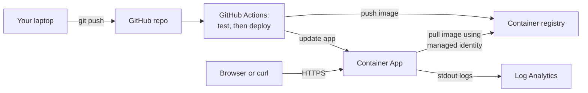
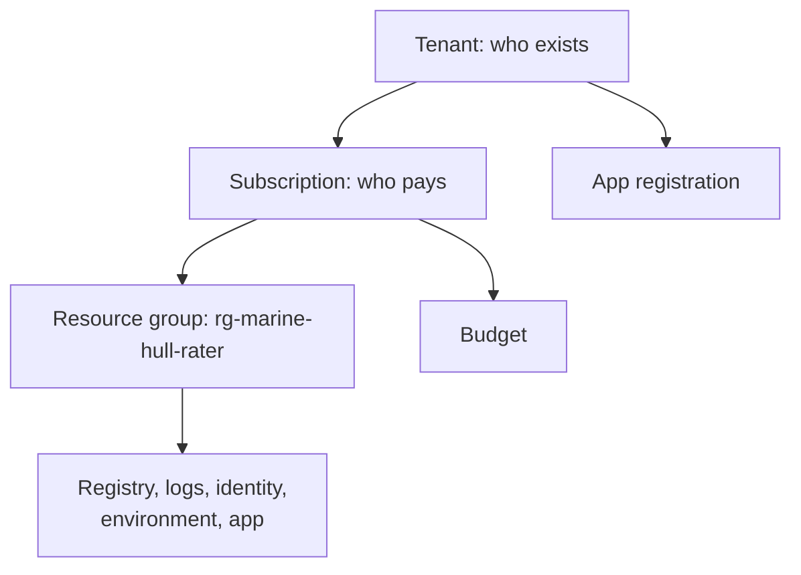
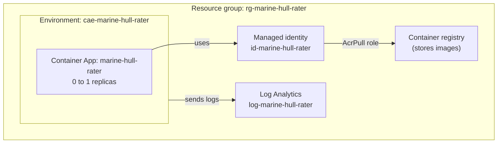
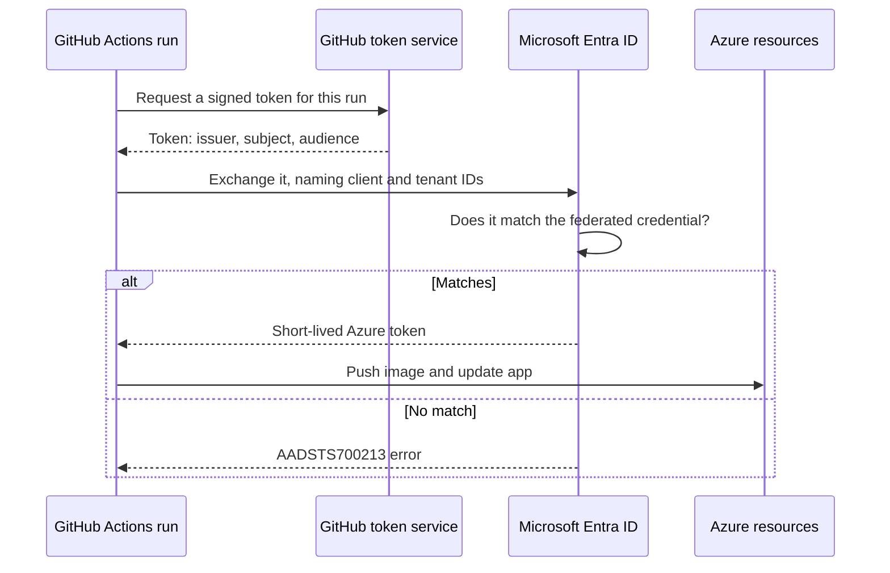
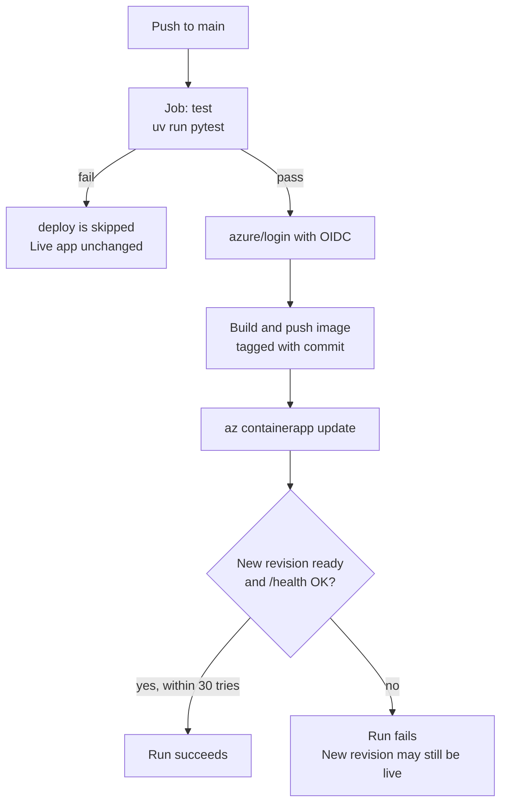
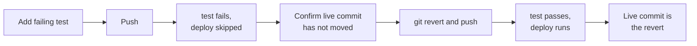
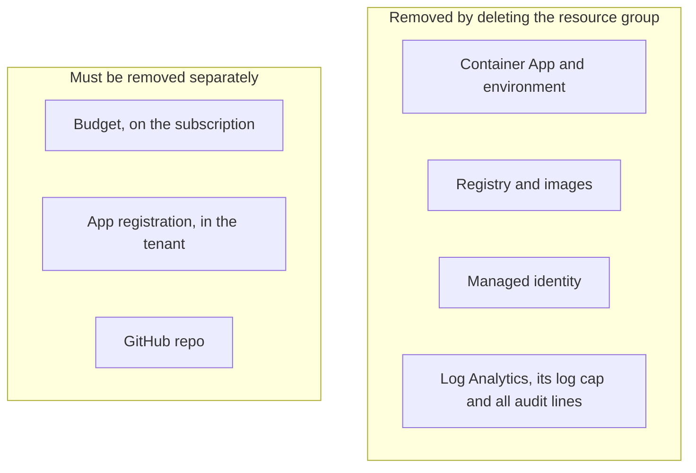

# Marine hull rater: build and deploy it from scratch

This guide takes you from no accounts and no project to a live web app on Azure, with automatic testing and deployment. It then takes everything down again. It assumes you are comfortable with Python and data, but not with cloud infrastructure or software deployment.

**All rates in this project are made up.** They are illustrative, are not based on any real pricing, and must not be used to price real risks.

## How to read this guide

Each command comes with four things: **what** it does, **why** it is needed, what **success** looks like, and common **errors**.

Errors are labelled so you can tell record from advice:

- **Really happened**: recorded in `docs/deploy-log.md`, or seen when this guide was checked.
- **Possible**: general advice. It did not happen on this project.

Each command also has a tag showing how it was checked:

| Tag | Meaning |
|---|---|
| `[Ran]` | Run successfully on a Mac while this guide was checked, on 2026-11-05. It was local or read-only |
| `[Log]` | Changes something in Azure or GitHub, so it was not re-run. It matches `docs/deploy-log.md` |
| `[Repo]` | Not re-run. It matches a file in this repo, such as the README or workflow |
| `[Not in log]` | Added so the guide is complete. It is not recorded in the log and was not run |

[Appendix A](#appendix-a-what-the-deploy-log-does-not-record) lists every place where the guide goes beyond the log.

### Placeholders

Anything in angle brackets is a value you must replace, including the brackets. If you leave them in, the shell reads `<` and `>` as file redirection and you get a confusing error. Commands also name the repo `mmadahar/marine-hull-rater`. If you rebuild under your own GitHub account, use your own name there.

| Placeholder | What it is | How to find it |
|---|---|---|
| `<subscription-id>` | The Azure subscription | `az account show --query id -o tsv` |
| `<tenant-id>` | Your Azure directory | `az account show --query tenantId -o tsv` |
| `<account-email>` | Your sign-in email | `az account show --query user.name -o tsv` |
| `<registry>` | Registry name, which you choose. Letters and numbers only, and unique across all of Azure | `az acr list -g rg-marine-hull-rater --query "[].name" -o tsv` |
| `<registry-resource-id>` | The registry's full Azure path | `az acr show -n <registry> --query id -o tsv` |
| `<resource-group-id>` | The resource group's full Azure path | `az group show -n rg-marine-hull-rater --query id -o tsv` |
| `<identity-resource-id>` | The managed identity's full Azure path | `az identity show -g rg-marine-hull-rater -n id-marine-hull-rater --query id -o tsv` |
| `<identity-principal-id>` | The managed identity's ID for role assignments | Same command, with `--query principalId` |
| `<app-id>` | The app registration's ID, also called the client ID | `az ad app list --display-name github-marine-hull-rater --query "[].appId" -o tsv` |
| `<sp-object-id>` | The service principal's ID | `az ad sp show --id <app-id> --query id -o tsv` |
| `<owner-github-id>`, `<repo-github-id>` | GitHub's numeric IDs | `gh api repos/mmadahar/marine-hull-rater --jq '.owner.id, .id'` |
| `<app-fqdn>` | The live web address, without `https://` | `az containerapp show -g rg-marine-hull-rater -n marine-hull-rater --query properties.configuration.ingress.fqdn -o tsv` |
| `<run-id>` | One workflow run | `gh run list -R mmadahar/marine-hull-rater` |
| `<revision>` | One version of the deployed app | `az containerapp show -g rg-marine-hull-rater -n marine-hull-rater --query properties.latestReadyRevisionName -o tsv` |
| `<quote-id>` | One quote | The `quote_id` in a quote response |

All of these lookups are read-only, and all were run when this guide was checked.

### The finished system



You push code. GitHub tests it. If the tests pass, GitHub builds an image, stores it in your registry, and tells the app to run it. Each quote writes a line to the logs.

## 1. Prerequisites and accounts

### What you need

- **An Azure account**, from <https://azure.microsoft.com/free/>. You will need a payment card, even for free credit. This project costs real money while it exists, though only a little ([section 9](#9-the-budget-alert) sets an alert).
- **A GitHub account**, from <https://github.com/signup>.
- **A subscription.** This is Azure's billing container. Everything you create belongs to one subscription, and its charges go to one bill. An account can have several. A new account normally gets one, and this project used one called `Azure subscription 1`.
- **A tenant.** This is your organisation's directory of users and app identities, run by Microsoft Entra ID. A personal account gets one automatically. You will need its ID later.



### Install the tools

`[Not in log]` The log begins with the tools already installed. On a Mac with [Homebrew](https://brew.sh):

```sh
brew install uv azure-cli gh git
```

Install [Docker Desktop](https://www.docker.com/products/docker-desktop/) and start it.

- **What:** installs the Python project manager, the Azure and GitHub command-line tools, and version control.
- **Why:** every later step uses them.
- **Success:** these print versions. `[Ran]`

```sh
uv --version
az version
gh --version
git --version
docker --version
```

The versions used when this guide was checked were uv 0.13.0, Azure CLI 2.92.0, gh 2.102.0, git 2.56.0 and Docker 29.8.2.

- **Errors (possible):** `command not found` means the install failed, or your terminal needs reopening.

### A note on zsh and copied URLs

**Really happened, while checking this guide.** The default Mac shell, zsh, treats `?` as a filename wildcard. An unquoted URL containing `?` fails:

```text
zsh: no matches found: repos/.../probe.yml?ref=...
```

Put quotes around any URL with a `?` in it. The commands in this guide do that.

## 2. The Azure CLI and `az login`

A **CLI** (command-line interface) is a program you control by typing. The Azure CLI, `az`, does what the Azure web portal does. It is used here because commands can be recorded and repeated.

### Sign in

`[Not in log]` This changes only your local sign-in.

```sh
az login
```

- **What:** opens a browser so you can sign in, then stores a sign-in token on your machine.
- **Why:** `az` needs to know who you are before Azure will do anything.
- **Success:** it lists your subscriptions.
- **Errors (possible):** with several subscriptions, you may be asked to choose one. No subscriptions found means the account has no active subscription yet.

### Check where you are

`[Ran]`

```sh
az account show
```

- **What:** shows the signed-in user and current subscription.
- **Why:** you must be sure which subscription will be billed before creating anything.
- **Success:** JSON with `"state": "Enabled"`. Save the `id` and `tenantId` values for later. They are identifiers, not passwords, but keep them out of the repo.
- **Errors (possible):** `Please run 'az login'` means your sign-in has expired.

### Sign in to GitHub

`[Not in log]`

```sh
gh auth login
```

- **What:** signs the `gh` tool in to GitHub.
- **Why:** later commands create the repo and set its secrets.
- **Success:** `gh auth status` reports that you are logged in.

## 3. `uv`, Python pinning, running and testing locally

**uv** creates a project's isolated Python environment and installs its packages. It does the job of `pip`, `venv` and `pyenv` together.

### Get the code

The simplest route, if the repo still exists, is `[Ran]`:

```sh
gh repo clone mmadahar/marine-hull-rater
cd marine-hull-rater
```

- **What:** downloads the repo and its full history.
- **Success:** a new folder containing `pyproject.toml`.
- **Errors (possible):** `Could not resolve to a Repository` means it does not exist or your account cannot see it. The repo is private.

If the repo is gone, you need your own copy of the code. This is why [teardown](#12-teardown) tells you to keep one first.

### Or start an empty project

`[Ran]`, in a temporary folder. The `git` lines are not in the deploy log, except for the branch rename, which it records as `git branch -m master main`.

```sh
mkdir marine-hull-rater
cd marine-hull-rater
git init -b main
uv init --bare --name marine-hull-rater
uv python pin 3.14
uv add fastapi uvicorn
uv add --dev pytest httpx2
```

- **What:**
  - `git init` starts version control.
  - `uv init --bare` creates a minimal `pyproject.toml`.
  - `uv python pin 3.14` writes `3.14` to `.python-version`, the "pin", so every machine uses the same Python.
  - `uv add` adds packages and records exact versions in `uv.lock`. `--dev` marks ones needed only for testing, which keeps them out of the deployed image.
- **Why:** pinning means your laptop, the test run and the live image all use the same versions.
- **Success:** `pyproject.toml`, `.python-version`, `uv.lock` and `.venv/` all exist.

Then edit `pyproject.toml` to match the repo's version. The scaffold does not generate these parts:

```toml
requires-python = ">=3.14,<3.15"

[tool.uv]
package = false

[tool.pytest.ini_options]
testpaths = ["tests"]
pythonpath = ["."]
```

`package = false` tells uv this is an app, not a library to publish. `pythonpath` lets tests import `app` and `rater`.

### What each file does

Write the files in this order. The commit history follows the same order, so `git show 860e650`, `e122731` and `11cf801` show each stage.

| Path | Job |
|---|---|
| `rates/v1.toml` | The made-up rates, and the valid inputs. Change prices here, not in code |
| `rater/rates.py` | Loads the rates file |
| `rater/engine.py` | Works out a quote from inputs and rates |
| `rater/result.py` | The shape of a quote's result |
| `tests/fixed_quotes.toml` | Quotes with expected answers worked out separately from the rater |
| `tests/test_rater.py`, `tests/test_api.py` | The tests |
| `app/main.py` | The web API: `/quote`, `/options`, `/health` |
| `app/rate_limit.py` | Refuses a client's 31st quote in 60 seconds |
| `app/static/` | The web page |
| `Dockerfile`, `.dockerignore` | How to build the image, and what to leave out |
| `.github/workflows/deploy.yml` | The test and deploy pipeline |

### How a quote is worked out

Take the fixed test quote `modern_bulker`, a 30,000 tonne bulk carrier.

1. **Base premium.** Each slice of tonnage is charged at its own band's rate, like income tax: 5,000 × 6.00 + 15,000 × 3.00 + 10,000 × 1.60 = 91,000.
2. **Multipliers,** applied in file order: age 0.92, flag 0.95, class 1.00, area 1.00, deductible 0.96, claims 0.95.
3. **Technical premium:** 91,000 × all of those = 72,535.01.
4. **Sense checks,** which never change the premium: 72,535.01 ÷ 30,000 = 2.42 per tonne, and 72,535.01 ÷ 28,000,000 = 0.259% rate on hull value.
5. **Refer flag:** `refer_to_underwriter` is true when the rate on hull value is above `refer_above_pct = 2.5` in the rates file. It is only a flag, and nothing stops the quote.

The code uses `Decimal`, not floats, so money stays exact. Each factor's effect is the difference between rounded running totals, so the effects add up exactly to the premium.

### Install the dependencies

`[Ran]`

```sh
uv sync
```

- **What:** makes `.venv` match `uv.lock` exactly.
- **Why:** this gives you the same packages as the test run.
- **Success:** `Resolved 25 packages` and `Checked 22 packages`, or a list of installs on a first run.
- **Errors (possible):** a message that no interpreter meets the requirement means Python 3.14 is not available. Run `uv python install 3.14`.

### Run the tests

`[Ran]`

```sh
uv run pytest
```

- **What:** runs every test inside the project's environment.
- **Why:** these same tests decide later whether a release can go out.
- **Success:** the check at the current commit gave `93 passed`. The deploy log's baseline says 90 because it was taken earlier, and the count has grown since.
- **Errors (possible):** `ModuleNotFoundError` usually means you ran plain `pytest`, not `uv run pytest`, or `pythonpath` is missing from `pyproject.toml`.

### Run the app

`[Ran]`, on a different port because 8000 was in use for the Docker check. The README uses:

```sh
uv run uvicorn app.main:app --reload --port 8000
```

- **What:** **uvicorn** is the web server. `app.main:app` means "the object `app` in `app/main.py`". `--reload` restarts it when you change code.
- **Why:** you can try the app with no cloud at all.
- **Success:** open <http://localhost:8000> to see the quote page. In a second terminal, `curl http://localhost:8000/health` returns `{"status":"ok"}`. Press Ctrl+C to stop.
- **Errors (possible):** `address already in use` means something else holds that port. Stop it or pick another port.

## 4. Docker: images and containers

An **image** is a sealed package holding your app, its Python and its operating system files. A **container** is a running copy of an image. It is like a class and an instance: one image can start many containers.

Azure runs containers, so the thing you test locally is the same thing that runs live.

### Read the Dockerfile

A `Dockerfile` is the recipe for an image. Each line adds a layer, which Docker reuses if nothing has changed.

| Line | Meaning |
|---|---|
| `FROM python:3.14-slim` | Start from a small official Python image |
| `ENV UV_PYTHON_DOWNLOADS=never ...` | Use the image's Python, keep no caches, and print logs straight away |
| `RUN pip install --no-cache-dir uv==0.13.0` | Install a fixed version of uv |
| `WORKDIR /srv` | Work in this folder from now on |
| `COPY pyproject.toml uv.lock .python-version ./` | Copy the dependency files first, so code changes don't force a reinstall |
| `RUN uv sync --frozen --no-dev` | Install exactly what the lock file says, without test packages |
| `COPY rater ...`, `rates ...`, `app ...` | Copy the project code |
| `RUN useradd ...` and `USER app` | Run as an ordinary user, who cannot change the root-owned files |
| `ARG GIT_COMMIT=local` and `ENV GIT_COMMIT=$GIT_COMMIT` | Bake the commit into the image, so each quote can state which code priced it |
| `EXPOSE 8000` | Note that the app listens on port 8000 |
| `CMD [...]` | The command to run on start |

`.dockerignore` starts with `*`, which excludes everything, then lists what to include. That keeps `.env` files and `.git` out of the image.

Two flags in `CMD` matter:

- `--no-proxy-headers` leaves `X-Forwarded-For` for the rate limiter to read itself ([section 11](#11-testing-the-live-app-including-the-rate-limit)).
- `--no-access-log` keeps normal stdout to the audit lines alone.

### Build the image

`[Ran]`

```sh
docker build --build-arg GIT_COMMIT="$(git rev-parse HEAD)" -t marine-hull-rater .
```

- **What:** follows the Dockerfile. `-t` names the image, `.` means "use this folder", and `--build-arg` passes in the current commit.
- **Why:** to prove the image builds before the pipeline tries.
- **Success:** ends with `naming to docker.io/library/marine-hull-rater:latest done`. The image was 272MB when checked.
- **Errors (possible):** `Cannot connect to the Docker daemon` means Docker Desktop is not running. `failed to compute cache key ... not found` usually means `.dockerignore` excludes a file the Dockerfile copies.

### Run the container

`[Ran]`

```sh
docker run --rm -p 8000:8000 marine-hull-rater
```

- **What:** starts a container. `-p 8000:8000` connects port 8000 on your Mac to port 8000 inside. `--rm` deletes the container when it stops.
- **Why:** to test the same package that will run in Azure.
- **Success:** `Uvicorn running on http://0.0.0.0:8000`.
- **Errors (possible):** `port is already allocated` means something else is on 8000. Use `-p 8001:8000` and go to port 8001.

### Send it a quote

`[Ran]` Save the fixed test quote outside the repo, so that it is not committed by accident. The deploy log used a file called `q.json` but did not keep its contents, so this one was rebuilt from `tests/fixed_quotes.toml`.

```sh
mkdir -p "$HOME/mhr-scratch"
cat > "$HOME/mhr-scratch/q.json" <<'EOF'
{"vessel_type":"bulk_carrier","gross_tonnage":30000,"vessel_age":3,"flag_tier":"tier_1","iacs_class":"yes","trading_area":"worldwide","deductible":150000,"claims_count_5yr":0,"agreed_hull_value":28000000}
EOF
curl -X POST http://localhost:8000/quote -H 'content-type: application/json' -d @"$HOME/mhr-scratch/q.json"
```

- **What:** `curl` sends a web request from the command line. This one posts the file as the quote.
- **Why:** it tests the real API end to end, with a known answer.
- **Success:** JSON with `"technical_premium":"72535.01"`, `"rate_on_hull_value_pct":"0.259"`, `"refer_to_underwriter":false`, a new `quote_id`, and your commit in `git_commit`.
- **Errors:** a bad input gets status `422`, with one message per field. That is by design. `Connection refused` (possible) means the container is not running.

To see the refer flag turn on, `[Ran]`:

```sh
curl -X POST http://localhost:8000/quote -H 'content-type: application/json' -d '{"vessel_type":"general_cargo","gross_tonnage":3000,"vessel_age":22,"flag_tier":"tier_3","iacs_class":"no","trading_area":"regional","deductible":100000,"claims_count_5yr":2,"agreed_hull_value":2000000}'
```

**Success:** `"technical_premium":"57220.02"`, `"rate_on_hull_value_pct":"2.861"`, `"refer_to_underwriter":true`.

### Test the rate limit locally

`[Ran]` Start a fresh container first, since the quotes above count towards the limit.

```sh
for i in $(seq 1 31); do curl -s -o /dev/null -w '%{http_code}\n' -X POST http://localhost:8000/quote -H 'content-type: application/json' -d @"$HOME/mhr-scratch/q.json"; done | sort | uniq -c
```

**Success:**

```text
  30 200
   1 429
```

`200` means OK, and `429` means too many requests. Bad requests count too. In the first check, three earlier requests had used up part of the window, so the result was 27 × 200 and 4 × 429.

### Stop the container

Press Ctrl+C in its terminal. If you started it in the background with `-d --name <name>`, use `[Ran]`:

```sh
docker stop <name>
```

- **Success:** `docker ps` no longer lists it. `--rm` has removed it too.

## 5. Azure basics

These commands create things that may cost money. Each has been checked against the deploy log only. They were not re-run.

Current Azure state was confirmed read-only: all five resources below exist in UK South, the app is set to 0 to 1 replicas with 0.25 CPU and 0.5Gi memory, and the registry is Basic with its admin user off.



### Providers

A **resource provider** is the Azure service behind a type of resource. A new subscription must switch on each one before using it.

`[Log]` Run this once each for `Microsoft.App`, `Microsoft.OperationalInsights`, `Microsoft.ContainerRegistry` and `Microsoft.ManagedIdentity`:

```sh
az provider register -n Microsoft.App --wait
```

- **What:** registers the provider. `--wait` holds until it finishes.
- **Why:** without this, creating those resources fails.
- **Success:** `az provider show -n Microsoft.App --query registrationState -o tsv` prints `Registered`. `[Ran]` All four show that now.
- **Errors (really happened):** the log records all four starting as `NotRegistered` and taking about 5 minutes in total. One command ran past a 3-minute shell limit, and was left running in the background.

### Resource group

A **resource group** is a folder for related resources. Deleting the group deletes everything in it, which makes teardown simple.

`[Log]`

```sh
az group create -n rg-marine-hull-rater -l uksouth
```

- **What:** creates the group in the UK South region.
- **Why:** everything else needs somewhere to go.
- **Success:** JSON with `"provisioningState": "Succeeded"`.
- **Errors (possible):** `AuthorizationFailed` means your account lacks rights on this subscription.

### Container registry

A **container registry** is private storage for images. It is to images what GitHub is to code.

`[Log]`

```sh
az acr create -g rg-marine-hull-rater -n <registry> --sku Basic --admin-enabled false
```

- **What:** creates a registry at `<registry>.azurecr.io`. **SKU** means pricing tier. `--admin-enabled false` turns off its shared admin password.
- **Why:** the app needs somewhere to pull images from. With no password, there is none to leak.
- **Success:** JSON with `"loginServer"`.
- **Errors (possible):** `AlreadyInUse` means another Azure customer has that name. Add a random suffix.

### Log Analytics

A **Log Analytics workspace** collects logs and lets you search them later.

`[Log]`

```sh
az monitor log-analytics workspace create -g rg-marine-hull-rater -n log-marine-hull-rater -l uksouth --retention-time 30
```

- **What:** creates the workspace and keeps logs for 30 days.
- **Why:** containers come and go, so their logs must be stored somewhere else. This is also the only store of the quote audit trail, so a quote's log line is gone after 30 days.
- **Success:** JSON with `"provisioningState": "Succeeded"`.

### Managed identity

A **managed identity** is an Azure-managed account for a program. It has no password you handle. Here, the live app uses it to pull images.

`[Log]`

```sh
az identity create -g rg-marine-hull-rater -n id-marine-hull-rater -l uksouth
```

- **What:** creates the identity.
- **Why:** the app needs to prove who it is to the registry.
- **Success:** JSON with `principalId` and `id`.

A **role** is a named set of permissions. A **scope** is where it applies.

`[Log]`

```sh
az role assignment create --assignee-object-id <identity-principal-id> --assignee-principal-type ServicePrincipal --role AcrPull --scope <registry-resource-id>
```

- **What:** allows this identity to pull images, from this registry only.
- **Why:** an identity starts with no rights. Keeping the scope narrow limits any damage.
- **Success:** JSON showing the role. `[Ran]` `az role assignment list --assignee <identity-principal-id> --all` confirms `AcrPull` on the registry.
- **Errors (possible):** `PrincipalNotFound` straight after creating an identity means Azure hasn't caught up. Wait a minute and retry.

### Container Apps environment

An **environment** is the shared space that Container Apps run in. It sets where their logs go.

`[Log]` The log summarises the first two lines below with `...`, so they are written out in full here. `show` was run, but `get-shared-keys` was not, to avoid printing a secret.

```sh
WORKSPACE_ID=$(az monitor log-analytics workspace show -g rg-marine-hull-rater -n log-marine-hull-rater --query customerId -o tsv)
WORKSPACE_KEY=$(az monitor log-analytics workspace get-shared-keys -g rg-marine-hull-rater -n log-marine-hull-rater --query primarySharedKey -o tsv)
az extension add --name containerapp --upgrade
az containerapp env create -g rg-marine-hull-rater -n cae-marine-hull-rater -l uksouth --logs-workspace-id "$WORKSPACE_ID" --logs-workspace-key "$WORKSPACE_KEY"
```

- **What:** reads the workspace ID and key into shell variables, adds the Container Apps extension to the CLI, then creates the environment linked to the workspace.
- **Why:** the key lets the environment write logs. A shell variable keeps it out of files, and it disappears when you close the terminal.
- **Success:** JSON with `"provisioningState": "Succeeded"`, after about 3 minutes.
- **Errors (really happened):** `az extension add --name containerapp --upgrade` gave `Pip failed with status code 1`. The upgrade failed locally, but this did not block anything because the installed version worked. The pipeline installs its own.

### Container App

A **Container App** is your running service. Azure handles the web address, HTTPS and starting containers. **Ingress** is the front door that lets web traffic in.

`[Log]`

```sh
az containerapp create -g rg-marine-hull-rater -n marine-hull-rater --environment cae-marine-hull-rater --image mcr.microsoft.com/k8se/quickstart:latest --user-assigned <identity-resource-id> --registry-server <registry>.azurecr.io --registry-identity <identity-resource-id> --ingress external --target-port 8000 --min-replicas 0 --max-replicas 1 --cpu 0.25 --memory 0.5Gi
```

| Flag | Meaning |
|---|---|
| `--image ...quickstart:latest` | A public placeholder image. Your registry is still empty, and the first workflow run replaces this |
| `--user-assigned`, `--registry-identity` | Give the app the identity, and use it to pull from the registry |
| `--ingress external` | Reachable from the public internet, with no login |
| `--target-port 8000` | Send traffic to the port uvicorn listens on |
| `--min-replicas 0 --max-replicas 1` | Scale to zero when idle, and never run more than one |
| `--cpu 0.25 --memory 0.5Gi` | The size of each replica |

- **Why:** the workflow updates an existing app. It does not create one.
- **Success:** JSON with `"provisioningState": "Succeeded"` and a `fqdn`, the public address.
- **Errors (possible):** a failure to pull from the registry means the `AcrPull` role is missing or has not taken effect yet.

### Replicas, revisions and scale to zero

A **replica** is one running copy of your container. A **revision** is one deployed version of the app, and each new image creates a new one.

**Scale to zero** means no replica runs when there is no traffic, so you pay no compute. The next request starts one, which is called a **cold start**. The deploy log measured this:

| Measurement | Result |
|---|---|
| Time from last request to 0 replicas (`ScaledToZero`) | About 6 minutes |
| Cold start response | 21.2 seconds |
| Warm response | 0.08 seconds |

The registry and log storage still have costs at zero replicas.

Because of the cold start, the quote page tells visitors that the first quote may take about 20 seconds while the app wakes up.

The limit of one replica matters too, since the rate limiter holds its counts in that replica's memory. A restart or scale to zero clears them, and two replicas would each keep their own count.

`[Ran]` To see the replicas:

```sh
az containerapp replica list -g rg-marine-hull-rater -n marine-hull-rater --revision <revision>
```

**Success:** a list of replicas, which is empty when scaled to zero.

To repeat the cold start measurement, `[Log]`:

```sh
curl -w '%{time_total}' https://<app-fqdn>/health
```

## 6. OIDC: signing in with no stored password

GitHub needs to change things in Azure when it deploys. The old approach is to store an Azure password in GitHub, which can leak and has to be rotated.

**OIDC** (OpenID Connect) replaces the password. For each run, GitHub issues a short-lived signed token saying "this is a run on the `main` branch of this repo". Azure checks the signature and compares those details to a rule you set up. If they match, it hands back a short-lived Azure token.



Three new terms:

- **App registration:** the identity's definition in your tenant. Its ID is the client ID.
- **Service principal:** that identity's working presence in the tenant, which is what roles are granted to.
- **Federated credential:** the rule saying which outside tokens to trust. It has three parts: **issuer** (who signed it), **subject** (which repo and branch), and **audience** (who the token is for).

This project has two separate identities. The **managed identity** is used by the app to pull images. The **app registration** is used by the pipeline to push images and update the app.

### Create the identity

`[Log]`

```sh
az ad app create --display-name github-marine-hull-rater
az ad sp create --id <app-id>
```

- **What:** creates the app registration, with no client secret, and then its service principal.
- **Why:** the pipeline needs an identity to hold roles.
- **Success:** JSON from each. Take `appId` from the first and `id` from the second, which is `<sp-object-id>`. `[Ran]` The live registration has zero password credentials.

### Create the federated credential

`[Log]` The log records the fields but did not keep `fc.json`, so this file is rebuilt from them and from a read-only view of the live credential. Keep it outside the repo.

`fc.json`:

```json
{
  "name": "github-main-push",
  "issuer": "https://token.actions.githubusercontent.com",
  "subject": "repo:mmadahar/marine-hull-rater:ref:refs/heads/main",
  "audiences": ["api://AzureADTokenExchange"]
}
```

```sh
az ad app federated-credential create --id <app-id> --parameters fc.json
```

- **What:** tells Azure to trust tokens from GitHub for pushes to `main` of this repo.
- **Why:** this rule replaces the password. A run on another branch doesn't match, so it can't sign in.
- **Success:** JSON repeating these values.

### The numeric-subject error

**Really happened.** The first workflow run failed at `azure/login`:

```text
AADSTS700213: No matching federated identity record found
for presented assertion subject
repo:mmadahar@<owner-github-id>/marine-hull-rater@<repo-github-id>:ref:refs/heads/main
```

(Wrapped for the page. The log records the error code, the words "No matching federated identity record", and the subject.)

- **Cause:** GitHub issued a subject containing the numeric owner and repo IDs. The credential held the plain `repo:owner/name:...` form, and the match has to be exact.
- **Fix:** copy the subject from the failed login log, set the credential to it, and rerun the failed job.

`[Log]` The log shortens the JSON to `{...subject as presented...}`, so it is written out in full here:

```sh
az ad app federated-credential update --id <app-id> --federated-credential-id github-main-push --parameters '{"name":"github-main-push","issuer":"https://token.actions.githubusercontent.com","subject":"repo:mmadahar@<owner-github-id>/marine-hull-rater@<repo-github-id>:ref:refs/heads/main","audiences":["api://AzureADTokenExchange"]}'
gh run rerun <run-id> --failed
```

- **What:** replaces the rule's subject, then reruns only the jobs that failed.
- **Success:** the rerun passes. `[Ran]` Run history confirms it: attempt 1 of that run had `test` success and `deploy` failure, and attempt 2 had both succeed. The live subject has this numeric form, and its IDs match those returned by `gh api repos/mmadahar/marine-hull-rater`.

**If you rebuild,** expect this error on your first run, and treat the failed log as the place to read the right value. The repo has to exist before you can know its numeric ID, and in the logged order the credential comes first. Don't guess which form GitHub will issue: read what it presents.

### Grant the roles

`[Log]`

```sh
az role assignment create --assignee-object-id <sp-object-id> --assignee-principal-type ServicePrincipal --role "Container Apps Contributor" --scope <resource-group-id>
az role assignment create --assignee-object-id <sp-object-id> --assignee-principal-type ServicePrincipal --role AcrPush --scope <registry-resource-id>
az role assignment create --assignee-object-id <sp-object-id> --assignee-principal-type ServicePrincipal --role Reader --scope <registry-resource-id>
```

| Role | Scope | Why |
|---|---|---|
| Container Apps Contributor | Resource group | Update the app |
| AcrPush | Registry | Push images |
| Reader | Registry | `az acr login` has to read the registry resource |

- **Success:** `[Ran]` `az role assignment list --assignee <sp-object-id> --all` shows exactly these three.
- **Errors (possible):** `AuthorizationFailed` in a workflow step usually means one of these roles is missing, or was only just granted.

## 7. GitHub Actions

**GitHub Actions** runs commands on GitHub's machines when something happens in your repo. A **workflow** is the YAML file defining it. A workflow contains **jobs**, jobs contain **steps**, and each job runs on a fresh temporary machine called a **runner**.



### Create the repo and settings

`[Log]`

```sh
gh repo create mmadahar/marine-hull-rater --private --source . --remote origin
```

- **What:** creates an empty private GitHub repo and connects this folder to it, as the remote called `origin`.
- **Why:** the workflow lives and runs there.
- **Success:** it prints the repo URL. `git remote -v` shows `origin`.
- **Errors (possible):** `Name already exists` means the repo is already there.

**Secrets** are encrypted settings that GitHub hides in logs. **Variables** are plain settings. These IDs aren't passwords, but there's no reason to expose them, so they are stored as secrets. The registry name is a variable because it ends up in image names.

`[Log]` Each `gh secret set` prompts you to paste the value.

```sh
gh secret set AZURE_CLIENT_ID
gh secret set AZURE_TENANT_ID
gh secret set AZURE_SUBSCRIPTION_ID
gh variable set ACR_NAME
```

- **Why:** the workflow reads them as `secrets.AZURE_CLIENT_ID` and `vars.ACR_NAME`. `AZURE_CLIENT_ID` takes `<app-id>`, and `ACR_NAME` takes `<registry>`.
- **Success:** `[Ran]` `gh secret list` and `gh variable list` show the names. Secret values can never be read back.
- **Errors (possible):** `azure/login` complaining about a missing `client-id` means a secret name is misspelled. `gh variable set` may need `--body "<registry>"`.

Then the first push, which starts the workflow, `[Log]`:

```sh
git add .
git commit -m "<message>"
git push -u origin main
```

**Success:** a run appears under `gh run list`. Expect the numeric-subject error from [section 6](#the-numeric-subject-error) at this point.

### The workflow, line by line

This is all of `.github/workflows/deploy.yml`, split into parts.

```yaml
name: Test and deploy

on:
  push:
    branches: [main]
```

The name shown on GitHub, and the trigger. Only a push to `main` starts it, so **every push to `main` is a release attempt.**

```yaml
permissions:
  contents: read

concurrency:
  group: deploy-main
  cancel-in-progress: false
```

The run gets read-only access to the repo by default. Runs in the same group take turns, and a new run doesn't cancel one that is halfway through a deployment.

```yaml
jobs:
  test:
    runs-on: ubuntu-24.04
    steps:
      - uses: actions/checkout@3d3c42e5aac5ba805825da76410c181273ba90b1 # v7.0.1
      - uses: astral-sh/setup-uv@68559e99cc807c1eb7e9238fd43a15bba460eec2 # v10.3.3
        with:
          version: "0.13.0"
          python-version: "3.14"
      # Includes the fixed test quotes in tests/fixed_quotes.toml.
      - run: uv run pytest
```

The `test` job, on a fresh Ubuntu machine.

- `uses` runs a ready-made **action**, a shared package of steps.
- The long hex string pins an exact version of that action, so nobody can change the code you run by moving a version label. The comment says which version it is.
- `checkout` downloads your code, and `setup-uv` installs uv and Python.
- `run` executes a shell command. If pytest fails, this job fails.

```yaml
  deploy:
    needs: test
```

**This line is the test gate.** `deploy` only starts if `test` passes.

```yaml
    runs-on: ubuntu-24.04
    permissions:
      contents: read
      id-token: write # Azure sign-in with OIDC. No stored password.
```

`id-token: write` lets this job ask GitHub for the OIDC token. Only this job can, so test code never gets the chance.

```yaml
    env:
      IMAGE: ${{ vars.ACR_NAME }}.azurecr.io/marine-hull-rater:${{ github.sha }}
      RESOURCE_GROUP: rg-marine-hull-rater
      APP_NAME: marine-hull-rater
```

Values for all steps in the job. `${{ ... }}` is filled in by GitHub. `github.sha` is the commit, so every image is tagged with the exact code it holds.

```yaml
    steps:
      - uses: actions/checkout@3d3c42e5aac5ba805825da76410c181273ba90b1 # v7.0.1
      - uses: azure/login@a641126d1b8aa4d1fa005f4f92df94a3a4c4c906 # v3.1.0
        with:
          client-id: ${{ secrets.AZURE_CLIENT_ID }}
          tenant-id: ${{ secrets.AZURE_TENANT_ID }}
          subscription-id: ${{ secrets.AZURE_SUBSCRIPTION_ID }}
```

Each job has its own machine, so it downloads the code again. `azure/login` then does the OIDC exchange. These three IDs say *which* identity to use. They prove nothing by themselves, because the proof is the signed token.

```yaml
      - name: Build and push the image
        run: |
          az acr login --name "${{ vars.ACR_NAME }}"
          docker build --build-arg GIT_COMMIT="$GITHUB_SHA" -t "$IMAGE" .
          docker push "$IMAGE"
```

`|` starts a multi-line script. This signs Docker in to the registry using the Azure token, builds the image with the commit baked in, and uploads it.

```yaml
      - name: Deploy
        run: |
          az extension add --name containerapp --upgrade --only-show-errors
          az containerapp update --name "$APP_NAME" --resource-group "$RESOURCE_GROUP" --image "$IMAGE" --only-show-errors --output none
```

Installs the CLI extension, then tells the app to run the new image. That creates a new revision.

```yaml
      - name: Check the new revision is ready and healthy
        run: |
          # Only look once the new revision serves traffic, or the check could pass against the old one.
          for attempt in $(seq 1 30); do
            state=$(az containerapp show --name "$APP_NAME" --resource-group "$RESOURCE_GROUP" \
              --query "[properties.latestRevisionName, properties.latestReadyRevisionName, properties.configuration.ingress.fqdn]" --output tsv)
            latest=$(sed -n 1p <<< "$state")
            ready=$(sed -n 2p <<< "$state")
            fqdn=$(sed -n 3p <<< "$state")
            if [ "$latest" = "$ready" ] && curl --fail --silent --max-time 30 "https://$fqdn/health"; then
              exit 0
            fi
            sleep 10
          done
          exit 1
```

It tries up to 30 times, 10 seconds or more apart.

- `az containerapp show` returns three lines: newest revision, newest ready revision, and address. `sed -n 1p <<< "$state"` takes line 1 from that text, and so on.
- It succeeds only when the newest revision is ready **and** `/health` answers. `--fail` makes curl treat an error status as a failure.
- `exit 0` means success. Reaching the final `exit 1` fails the step.

Two real bugs shaped this step. Both **really happened**:

| Symptom | Cause | Fix |
|---|---|---|
| First live quote after a successful run returned the previous commit | `az containerapp update` returns before traffic moves, so the health check passed against the old revision | Wait for the two revision names to match |
| Health-check step failed with exit code 1 even though the app was deployed and healthy | `read` returns non-zero when there's no trailing newline, and the step runs with `bash -e`, which stops at the first failing command | Read the values with `sed -n` instead |

The second one matters when reading run history. Commit `c51dedf` shows `test` success and `deploy` failure, even though the app was healthy. **A red deploy job does not mean the old version is still live,** so check which step failed. There's no automatic rollback.

### How the test gate blocks a release

- `needs: test` means failed tests skip the whole `deploy` job. No image is built and the app isn't touched.
- The fixed quotes are tests, so a change that moves a price from its expected value blocks the release too.
- The gate guards **deployment**, not the branch. A failing commit still lands on `main` and needs fixing or reverting. `[Ran]` GitHub's branch protection API returned an upgrade message for this private repo on its current plan, so nothing stops a push at the door.

## 8. Viewing logs and finding a quote by ID

Every successful quote prints one JSON line to stdout, with its ID, model version, git commit, inputs and outputs. That's the audit trail. Refused quotes log nothing.

The app itself stores nothing, because there's no database. Azure collects stdout into Log Analytics.

### Recent logs

`[Ran]`, with `--tail 5`.

```sh
az containerapp logs show -g rg-marine-hull-rater -n marine-hull-rater --tail 200 --format text | grep <quote-id>
```

- **What:** reads recent output from the running replica and filters for your quote.
- **Why:** it's the quickest check, with no delay.
- **Success:** a line like this one, where `stdout F` marks standard output:

```text
<timestamp> stdout F {"quote_id": "<quote-id>", "model_version": "marine-hull-1.0.0", "git_commit": "<commit>", "inputs": {...
```

- **Errors (possible):** no line may just mean the replica that served it has scaled away or restarted. Use Log Analytics instead.

### Search all logs

`[Ran]` Log Analytics uses a query language called **KQL**. This query takes a table, filters it, and picks columns.

```sh
az rest --method post --url https://api.loganalytics.io/v1/workspaces/<workspace-id>/query --resource https://api.loganalytics.io --body '{"query":"ContainerAppConsoleLogs_CL | where Log_s has \"<quote-id>\" | project TimeGenerated, Log_s"}'
```

`<workspace-id>` is the `customerId` value from section 5. The log's version has no `project` part, and its quoting differs. This form was tested and returned the row.

- **What:** sends the query to the Log Analytics API, using your `az` sign-in.
- **Why:** this store survives replicas, for the 30 days of retention.
- **Success:** JSON with your line under `tables[0].rows`.
- **Errors (really happened):**
  - `az monitor log-analytics query` gave `Pip failed with status code 1`, because the CLI couldn't install its preview extension. That's why this `az rest` form is used.
  - A new line can take up to about 3 minutes to appear, so an empty result straight after a quote is normal.

## 9. The budget alert

A **budget** compares your spending to an amount and emails you when it crosses set percentages.

**It only alerts.** It doesn't stop, slow or delete anything, and spending can carry on past 100%. Cost data also reaches budgets with some delay, so an alert can arrive after the money is spent. To stop charges, you must tear down.

The log ran this before creating the repo (its step 4). You can do it at any point after your subscription exists, and earlier is better.

### Check your currency

`[Log]` A budget has no currency of its own, and uses your billing currency.

```sh
az billing account list
az billing profile list --account-name <billing-account>
```

**Really happened:** a run of billing queries was needed before this worked.

| Error | Cause | Fix |
|---|---|---|
| Cost Management query: `429 Too many requests` | Throttled just after registration | Retried |
| Cost Management retry: `NotFound ... doesn't have valid WebDirect/AIRS offer type` | Not yet available on this new subscription | Used the two commands above. Currency was GBP, so the budget of 20 is £20 |
| `az consumption budget list` (preview): `429` | Throttled | Listed budgets through `az rest` instead. None existed |
| usageDetails: `400 Billing Period is not supported` | The API needs date filters on this offer | Same |

The app's quotes are in USD, and that is a made-up figure in the rates file. It has nothing to do with the billing currency.

### Create the budget

`[Log]` `az rest` is used because `az consumption budget create` can't set notifications. The log's `budget.json` was kept outside the repo and not recorded, so this one is rebuilt from a read-only view of the live budget. Set `startDate` to the first of the current month.

`budget.json`:

```json
{
  "properties": {
    "category": "Cost",
    "amount": 20,
    "timeGrain": "Monthly",
    "timePeriod": {
      "startDate": "2026-11-01T00:00:00Z",
      "endDate": "2036-10-31T00:00:00Z"
    },
    "notifications": {
      "actual50": { "enabled": true, "operator": "GreaterThan", "threshold": 50, "thresholdType": "Actual", "contactEmails": ["<account-email>"] },
      "actual80": { "enabled": true, "operator": "GreaterThan", "threshold": 80, "thresholdType": "Actual", "contactEmails": ["<account-email>"] },
      "actual100": { "enabled": true, "operator": "GreaterThan", "threshold": 100, "thresholdType": "Actual", "contactEmails": ["<account-email>"] },
      "forecast100": { "enabled": true, "operator": "GreaterThan", "threshold": 100, "thresholdType": "Forecasted", "contactEmails": ["<account-email>"] }
    }
  }
}
```

The log's URL has no quotes. They are added here for zsh.

```sh
az rest --method put --url "https://management.azure.com/subscriptions/<subscription-id>/providers/Microsoft.Consumption/budgets/budget-monthly-20?api-version=2023-11-01" --body @budget.json
```

- **What:** creates a monthly budget of 20, alerting at 50%, 80% and 100% of actual spending, and 100% of forecast spending.
- **Why:** a mistake or forgotten resource gets noticed.
- **Success:** JSON echoing the budget. `[Ran]` A `get` to the same URL confirms the live budget has these settings.
- **Errors (possible):** a `400` about the start date usually means it isn't the first of a month.

The budget belongs to the subscription, not the resource group, so deleting the group leaves it behind.

### The daily log cap

The budget only warns you. The daily log cap actually limits something: how much log data the workspace accepts each day. Log Analytics charges by the amount of data it takes in, so heavy traffic could otherwise run up log charges.

`[Log]`

```sh
az monitor log-analytics workspace update -g rg-marine-hull-rater -n log-marine-hull-rater --quota 0.2
```

- **What:** caps log ingestion at 0.2 GB a day.
- **Why:** it puts a ceiling on one cost that outside traffic could drive up.
- **Success:** JSON showing `"dailyQuotaGb": 0.2` under `workspaceCapping`. `[Ran]` This read-only check confirms the live cap is 0.2, and shows the next reset time:

```sh
az monitor log-analytics workspace show -g rg-marine-hull-rater -n log-marine-hull-rater --query workspaceCapping
```

- **Errors (possible):** `ResourceNotFound` means the group or workspace name is wrong.

**The trade-off:** if the cap is hit, new log lines, **including audit lines**, are dropped until the daily reset. The app keeps running and keeps returning quotes, so those quotes would have no audit line, and the lines can't be recovered later. You are choosing a cost limit over a complete audit trail. That suits a demo with made-up rates. If [section 8](#8-viewing-logs-and-finding-a-quote-by-id) can't find a quote, check whether the cap was hit that day.

The cap covers log data only. It doesn't limit registry or compute costs.

## 10. A deliberate failed release

This proves that the gate works. Do it once after the pipeline is working. **Pushing to `main` starts the pipeline, and the revert will deploy for real.**



### Note the live version

`[Ran]`, in equivalent form.

```sh
az containerapp show -g rg-marine-hull-rater -n marine-hull-rater --query "properties.template.containers[0].image" -o tsv
```

**Success:** an image name that ends with the live commit. The log recorded the same fact as "live commit", without saying which command it used.

### Add a failing test

`[Log]` The log says `tests/test_gate.py` was added with `assert False`, committed and pushed. The exact file below ran locally in a temporary copy, and gave `1 failed, 93 passed`.

```python
def test_gate():
    assert False
```

```sh
git add tests/test_gate.py
git commit -m "Deliberate gate test: add a failing test to prove deployment is blocked"
git push
```

- **What:** releases a commit that's known to be bad.
- **Why:** a safety check you have never seen fail isn't proven.

### See that it was blocked

`[Ran]`, on the real gate-test run.

```sh
gh run list -R mmadahar/marine-hull-rater
gh run view <run-id> -R mmadahar/marine-hull-rater
gh run view <run-id> -R mmadahar/marine-hull-rater --log-failed
```

- **What:** lists runs, shows one run's jobs, then prints only the failed step's log.
- **Success, meaning the release was blocked:** the `test` job shows failure, and `deploy` shows skipped. `[Ran]` Commit `6eff72a` shows exactly this. Rerun the image command above: the commit must be unchanged.
- **Web view:** the repo's **Actions** tab shows the same thing.

### Undo it

`[Log]`

```sh
git revert HEAD --no-edit
git push
```

The log records `git revert`, then a push. `HEAD --no-edit` was added here, so the command runs without opening an editor.

- **What:** adds a new commit undoing the last one. History keeps the record, which you would lose by deleting the commit.
- **Success:** the run passes both jobs, the live commit moves to the revert, and `/health` is OK. All of this is recorded in the log. `[Ran]` The revert run, `3fff834`, shows success.

## 11. Testing the live app, including the rate limit

### Basic checks

`[Log]` The log used a `-d @q.json` file. Remember that a cold start can take over 20 seconds.

```sh
curl https://<app-fqdn>/health
curl https://<app-fqdn>/
curl -X POST https://<app-fqdn>/quote -H 'content-type: application/json' -d @"$HOME/mhr-scratch/q.json"
```

- **What:** checks health, the page, and the known quote.
- **Why:** local tests can't prove the live path works.
- **Success:** `{"status":"ok"}`, then HTML, then `"technical_premium":"72535.01"`, with `git_commit` matching your latest deployed commit.
- **Errors (really happened):** an old `git_commit` straight after a deploy was the revision timing bug in section 7. It should no longer happen.

### The rate limit

The limit is 30 quotes per client in any rolling 60 seconds. Other routes aren't limited. After the limit, you get status `429`, a `Retry-After: 60` header, and this message:

```json
{"errors":[{"field":"request","message":"Too many quotes, try again in a minute"}]}
```

The app identifies a client by address, using the `X-Forwarded-For` header. A client can send any value it likes in that header, but Azure's ingress **appends** the address it actually saw. So the app trusts only the **last** entry.

`198.51.100.x` below is a range reserved for documentation, so it can't belong to anyone.

`[Log]` Wait a full minute between each test, so the counts start clean. The log records the headers and results, and the loop's wording is rebuilt from the form in section 4.

```sh
for i in $(seq 1 31); do curl -s -o /dev/null -w '%{http_code}\n' -X POST https://<app-fqdn>/quote -H 'content-type: application/json' -H "X-Forwarded-For: 198.51.100.$i" -d @"$HOME/mhr-scratch/q.json"; done | sort | uniq -c
```

Two variations try to fool it in other ways, using the same loop with different header options:

```sh
-H "X-Forwarded-For: 10.0.0.$i, 198.51.100.$i"
-H "X-Forwarded-For: 10.0.0.$i" -H "X-Forwarded-For: 198.51.100.$i"
```

- **What:** sends 31 quotes while faking a new address each time, as a list, then as separate header lines.
- **Why:** a limit that can be dodged by changing a header wouldn't protect anything.
- **Success:** in each case, the log records 30 × 200, then a 429.

**This test only means something on the live app.** Locally, there's no ingress adding the true address, so a faked last entry works. `[Ran]` Locally, after the limit had been reached, three more quotes with fake addresses all returned 200. This is expected.

### Separate limits for separate clients

The log also needed to show that one client's limit doesn't block another. It kept sending quotes from the laptop for over 2 minutes, while a GitHub runner sent 31 of its own from a different address. The runner got 30 × 200 and then 429, while the laptop was getting 429s.

`[Log]` The workflow lived on a temporary branch holding only `probe.yml`. It didn't deploy, because the branch isn't `main`. Its full text is at commit `a1fdae0`. `[Ran]`

```sh
gh api "repos/mmadahar/marine-hull-rater/contents/.github/workflows/probe.yml?ref=a1fdae0" --jq .content | base64 -d
```

Afterwards, the branch was removed:

```sh
git push origin --delete rate-limit-probe
```

**Success:** the branch is gone. The result was that `app/rate_limit.py` needed no change.

## 12. Teardown



**This can't be casually undone.** Log lines go with the workspace, and if you delete the repo, the code goes too unless you have a copy. `[Repo]` The commands below match the README's teardown section. None were run.

### Before you start

Keep a copy of the code outside GitHub, and find the app ID. `[Ran]` for the lookup.

```sh
git status
git log origin/main --oneline -1
az ad app list --display-name github-marine-hull-rater --query "[].appId" -o tsv
```

**Success:** nothing unpushed or uncommitted that you need, and an ID printed.

### Delete the resource group

```sh
az group delete --name rg-marine-hull-rater
```

- **What:** deletes the group and everything in it, after asking you to confirm.
- **Why:** this stops the running costs.
- **Success:** it returns after some minutes with no error. `az group exists -n rg-marine-hull-rater` prints `false`. `[Not in log]`
- **Errors (possible):** `ResourceGroupNotFound` means it's already gone.

### Delete the budget

```sh
az rest --method delete --url "https://management.azure.com/subscriptions/<subscription-id>/providers/Microsoft.Consumption/budgets/budget-monthly-20?api-version=2023-11-01"
```

- **Why:** it's on the subscription, so the group delete left it behind. It costs nothing, but would keep sending alerts about anything else on the subscription.
- **Success:** no output and no error.

### Delete the app registration

```sh
az ad app delete --id <app-id>
```

- **Why:** it's in the tenant, not the group. Its service principal and federated credential go with it.
- **Success:** no output. The `az ad app list` lookup above now returns nothing.

### Delete the repo

Do this last, if you want to at all. Secrets and variables go with it.

```sh
gh repo delete mmadahar/marine-hull-rater
```

- **Success:** it asks you to type the name, then confirms.
- **Errors (possible):** a missing `delete_repo` permission. Fix this with `gh auth refresh -h github.com -s delete_repo`. `[Not in log]`

### What stays afterwards

`[Not in log]` Local clean-up, which is optional:

```sh
docker image rm marine-hull-rater
rm -rf "$HOME/mhr-scratch"
```

- **Provider registrations** stay on the subscription. They're free and harmless.
- **The subscription and account** stay. Close them in the Azure portal if you wish.
- **Final charges** can show up a little after you delete things, so check your bill the next month.
- **Names** may not be free to reuse at once, since Azure can hold some deleted items for a while.

## Appendix A: what the deploy log does not record

`docs/deploy-log.md` is the record of what was run on 2026-11-05. It has these gaps:

| Gap | What this guide does |
|---|---|
| Tool installs, `az login`, `gh auth login`, `git init`, and writing the project | Adds them, tagged `[Not in log]`. The `uv init` and `uv add` steps were tested in a temporary folder |
| Contents of `fc.json`, `budget.json` and `q.json` | Rebuilt from the log's fields, the live settings and the fixed test quotes |
| Full forms of commands shortened with `...` | Written out. For example, the workspace lookups and the federated credential's update JSON |
| The later commit `c86e225`, which added the refer-to-underwriter flag | Covered from the repo. `[Ran]` Its workflow run succeeded |
| The final push, and the checks after the last log entry | Not recorded. Read-only checks show the runs above passed. No live request was made while this guide was checked |
| Test count | The log's 90 is an earlier baseline. The current count is 93 |
| The later commit `d1d2f44`, which added the wake-up notice to the page | Covered from the repo. The log's section 7 records the cap, and `[Ran]` the live image tag is this commit |
| The way "live commit" was read during the gate test | Not recorded. The guide uses the image tag, which was run, and the `git_commit` in a quote |
| Exact rate-limit loop text | Rebuilt. Its results come from the log |
| The exact Log Analytics quoting | The log's form has nested single quotes that a shell would strip. This guide's form was tested |
| Full error text for `AADSTS700213` | Only the parts recorded in the log are relied upon |

Advice labelled "Possible" comes from general knowledge, not this project's record.

## Appendix B: order of work

1. Create the Azure and GitHub accounts, install the tools, and sign in.
2. Create the project and get the tests passing with uv.
3. Build and run the Docker image locally.
4. Register providers, then create the group, registry, logs, identity and role, environment and app.
5. Create the app registration, service principal, federated credential and three roles.
6. Set the budget and the daily log cap.
7. Create the repo, then set its secrets and variable.
8. Push. Fix the federated subject from the failed log, and rerun.
9. Test the live app, logs and rate limit.
10. Prove the gate with a deliberate failure, then revert.
11. When you've finished, tear it all down and check that nothing is left.
