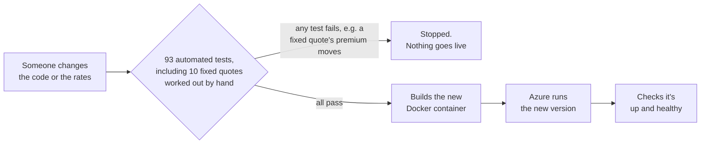

# How a change goes live

**A change to the code or the rates cannot go live if it moves the premium on a known quote.**

The tests include 10 fixed quotes whose expected premiums were worked out by hand, separately from the rater. Every change is checked against them automatically.

One of the fixed quotes:

| Quote | Ship | Expected premium, worked out by hand |
|---|---|---|
| modern_bulker | Bulk carrier, 30,000 GT, 3 years old | $72,535.01 |

All of this runs in GitHub Actions on every change, with nobody pressing a button.

For the technical detail, see [the architecture document](../architecture.md).
