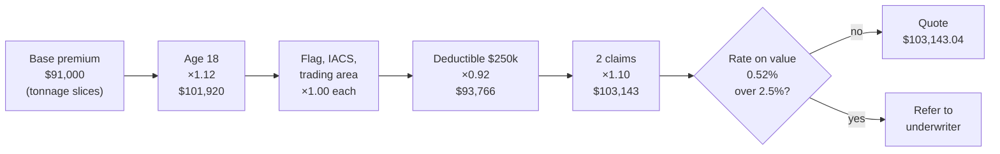

# How a quote is worked out

One worked example, run through the real rating engine.

**The ship:** a bulk carrier of 30,000 gross tonnes, 18 years old, tier 2 flag, IACS class member, trading worldwide, $250,000 deductible, 2 claims in the last five years, agreed hull value $20m.

| Step | Factor | Effect | Running premium |
|---|---|---|---|
| Base (5k × $6 + 15k × $3 + 10k × $1.60) | | | $91,000.00 |
| Age 18 | ×1.12 | +$10,920.00 | $101,920.00 |
| Flag tier 2 | ×1.00 | $0 | $101,920.00 |
| IACS member | ×1.00 | $0 | $101,920.00 |
| Worldwide | ×1.00 | $0 | $101,920.00 |
| Deductible $250k | ×0.92 | −$8,153.60 | $93,766.40 |
| 2 claims | ×1.10 | +$9,376.64 | **$103,143.04** |
| Sense check | 0.516% rate on value | under 2.5% | not referred |

By contrast, a 28-year-old non-IACS tanker of 30,000 GT, tier 3 flag, trading in high latitudes, with 3 claims and a $5m hull value, comes out at $395,343.00. That is a 7.9% rate on value, so it is referred to an underwriter.

All rates are made up for this demo.

For the technical detail, see [the architecture document](../architecture.md).
