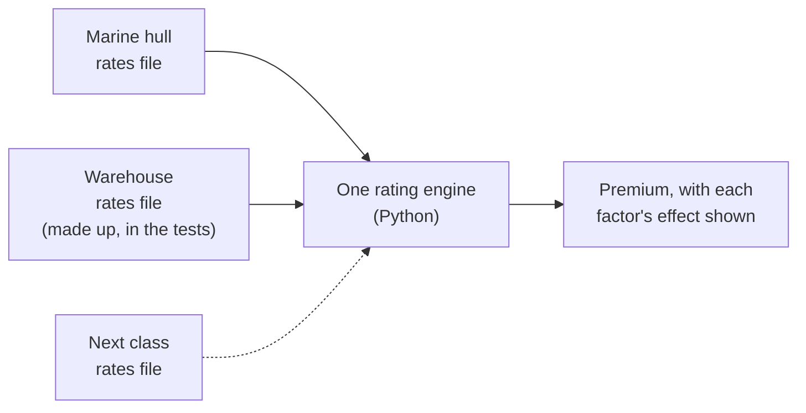

# Reusing it for other classes

The rating engine has nothing marine-specific in it. Every input, rate band, factor and the referral limit lives in the rates file, so each class of business gets its own rates file and they all share one engine.

The tests prove this: a made-up warehouse class is priced by the same, unchanged engine.

The rates live in a plain text file, not a spreadsheet, and every change to it is versioned and tested.

## What adding a real second class would still take

These are pretty simple changes:

- **Let the app choose a class.** Today it loads only the marine rates file.
- **Remove the marine wording.** A few labels on the web page, one marine-only check (deductible below hull value) and two field names in the output.
- **Add fixed test quotes for the new class,** worked out by hand, as marine has.

For the technical detail, see [the architecture document](../architecture.md#adding-another-class-of-business).
