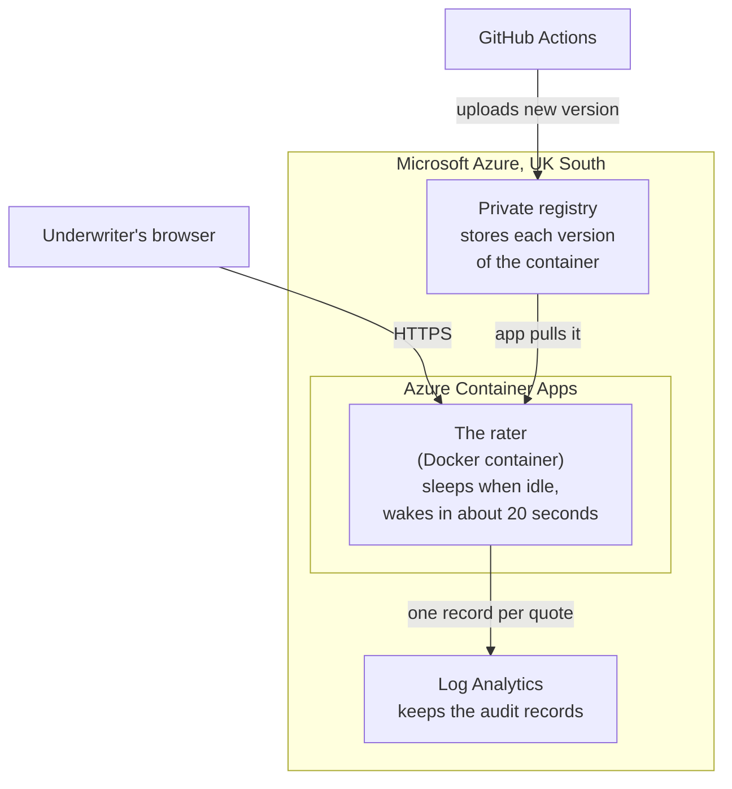

# Where it runs

| Part | What it does, in plain English |
|---|---|
| Azure Container Apps | Runs the rater. It switches off when nobody is using it, so it costs almost nothing, and the first visit wakes it in about 20 seconds. |
| Docker container | The app and its rates packed into one sealed box, so it runs exactly the same on a laptop as on Azure. |
| Private registry | A store of every version of that box. Azure runs the latest one. |
| Log Analytics | Where every quote's audit record is kept, for 30 days. |

For the technical detail, see [the architecture document](../architecture.md).
